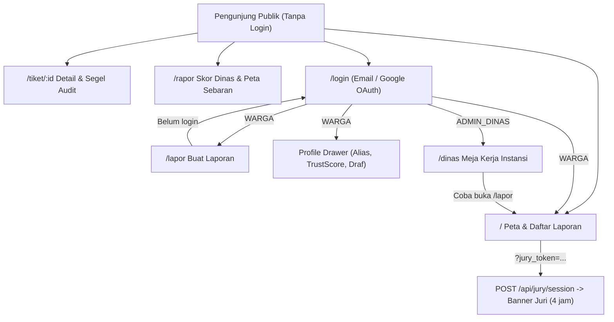
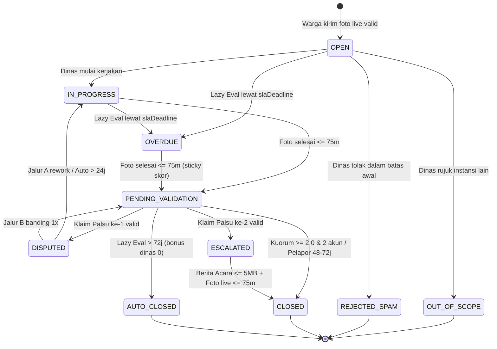

# LaporPAK! — Alur Pengguna & Arsitektur Alur Sistem (*User & System Flow*)

> **Acuan Tunggal:** Dokumen ini menurunkan spesifikasi [PRD v3.4](./PRD.md) dan [Design System](./design.md) menjadi alur langkah demi langkah untuk kebutuhan penyusunan arsitektur backend, rute frontend, dan QA. Pembagian tugas eksekusi dibahas terpisah.

---

## 1. Peta Navigasi & Penjaga Rute (*Sitemap & Role Guard*)



| Rute / Panel | Publik | `WARGA` | `ADMIN_DINAS` | Mode Juri (`X-Jury-Token`) | Perilaku Penjaga Rute (*Guard*) |
| :--- | :---: | :---: | :---: | :---: | :--- |
| **`/`**, **`/tiket/:id`**, **`/rapor`** | Buka | Buka | Buka *(tanpa tombol Lapor/Vote)* | Buka | Tanpa dinding login; dilarang membocorkan UUID, email, IP, atau koordinat presisi. |
| **`/login`** | Buka | Redirect `/` | Redirect `/dinas` | Buka *(pakai Role Switcher)* | Form email/password + tombol Google OAuth (khusus warga) + catatan jaminan anonimitas. |
| **`/lapor`** | Ke `/login` | Buka | Redirect `/` | Buka | Terkunci jika akun sedang `cooldownUntil > now`, `frozenUntil > now`, atau mencapai `5` tiket aktif *(di-bypass di sesi juri)*. |
| **`/dinas`** | Ke `/login` | Redirect `/` *(toast)* | Buka | Buka *(saat role Dinas aktif)* | Semua query & mutasi dikunci `where: { departmentId: req.user.departmentId }`. |
| **`/aktivasi-mitra`** *(Bonus Minggu 4)* | Ke `/login` | Tolak | Tolak *(hanya kode mitra)* | **Blokir (`403`)** | Terisolasi penuh dari sesi simulasi juri. |

---

## 2. Alur Pengguna (*User Flows* + Pemulihan *User Awam*)

### Flow A — Warga Melaporkan Kerusakan (`/lapor`)

1. **Pratinjau Sebelum Login (`/` -> `/lapor`):**
   - Jika belum login, klik **Lapor Kerusakan** mengarahkan ke `/login` dengan kartu jaminan: identitas disamarkan (`aliasName`, mis. `Warga-Delta-402`), koordinat publik dibulatkan `~11 m`, dan foto tanpa EXIF.
   - Setelah login, kembali otomatis ke `/lapor`.
2. **Langkah 1 — Penentuan Titik GPS & Pracegatan Kuota *(Sebelum Kamera Dibuka)*:**
   - **Jika izin GPS ditolak browser (`GeolocationPositionError`):** Tampilkan kartu pemulihan (*ketuk ikon gembok bilah alamat -> Izinkan Lokasi -> tombol Muat Ulang Posisi*).
   - **Jika akurasi GPS `> 50 m`:** Tampilkan nilai aktual (mis. `Akurasi 84 m — menepi ke area terbuka agar <= 50 m`) + tombol **Perbarui Lokasi**.
   - **Pin di luar poligon Sidoarjo–Surabaya (`+ buffer 500 m`):** Garis poligon menyala merah + pesan ramah (*"Lokasi di luar wilayah layanan Surabaya & Sidoarjo"*), tombol kamera tetap nonaktif.
   - **Panggil `GET /api/tickets/check-radius?lat=...&lng=...&category=...`:**
     - Jika kuota `50 m` kategori sama sudah `3/3` atau kuota global `30 m` sudah `6/6` -> kunci tombol kamera dan tampilkan daftar `nearbyTickets` + 1 klik **Dukung Prioritas** (warga tidak memotret sia-sia).
     - Jika `1–2` laporan sudah ada tapi kuota belum penuh -> tampilkan saran opsional *"Ada laporan serupa di dekat sini — mau dukung yang sudah ada atau lanjut buat baru?"*.
3. **Langkah 2 — Pra-Kamera & Pengambilan Foto *Live* WebRTC:**
   - Di atas tombol **Buka Kamera**, tampilkan teks singkat: alasan blokir galeri (*"Wajib foto langsung di TKP agar terbukti nyata & baru"*), pengingat keselamatan (*"Menepi di tempat aman"*), dan privasi (*"Hindari wajah & pelat nomor"*).
   - **Jika izin kamera ditolak:** Tampilkan kartu pemulihan izin + tombol **Coba Lagi**.
   - **Jika terdeteksi kamera virtual (`OBS` / `ManyCam` / `Virtual`) atau desktop tanpa kamera:** Blokir kamera virtual; khusus sesi `?jury_token=...`, tampilkan tombol **Simulasi Jepret Kamera Lapangan** (meminta `POST /api/capture-nonce` sah + memakai aset terkalibrasi `public/samples/`).
   - Klik **Buka Kamera** -> FE meminta `POST /api/capture-nonce` (`actionType: "CREATE_TICKET"`, `deviceFingerprint`, TTL `15 menit`).
   - Jepret (`canvas.toBlob('image/webp')`, `<= 1280 px`, `<= 450 KB`, 0% EXIF + watermark jam WIB & `publicLat`/`publicLng`) -> jalankan evaluasi client:
     - **Kecerahan BT.601:** tolak jika `Y > 245` atau `Y < 35` (`Y < 12` pada `18.00–05.30 WIB` untuk `JALAN_AMBLES`, `KABEL_MENJUNTAI`, `POHON_TUMBANG`, `PJU_MATI`, `SALURAN_TERSUMBAT`).
     - **Ketajaman Laplacian:** jika `variance < 45` pada jepret ke-1/ke-2 -> minta jepret ulang tanpa penalti; pada jepret ke-3 di sesi sama -> lanjut dengan `isLowQualityOverride: true` + banner *"Foto buram (kualitas terbatas)"*.
     - **Filter NSFW 2-Zona (`nsfwjs` via dynamic `import()` async):**
       - Skor `0.55–0.84` -> minta jepret ulang tanpa penalti.
       - Skor `>= 0.85` -> blokir unggahan, kirim lapor pelanggaran / hentikan submit, tampilkan penalti `-0.5 trustScore` (lantai `0.1` pelanggaran ke-1 akun `0.5`) + hitung mundur *cooldown* `24 jam`.
4. **Langkah 3 — Pengisian Catatan, Submit Idempoten & Ketahanan Jaringan:**
   - User mengisi deskripsi singkat -> tekan **Kirim Laporan**.
   - Tombol masuk status *submitting* (nonaktif + spinner `"Mengirim laporan..."`), memanggil `POST /api/tickets` dengan header `Idempotency-Key` dan `X-Device-Fingerprint`.
   - **Jika koneksi terputus / server `5xx`:** Input deskripsi, kategori, dan hasil blob foto **wajib tetap tersimpan utuh** -> munculkan pesan tenang + tombol **Kirim Ulang** (memakai `Idempotency-Key` yang sama), atau simpan ke draf lokal dengan banner *offline* (SLA mulai saat `syncedAt`).
   - **Jika server mengembalikan `409` kuota penuh (balapan saat submit):** Tampilkan toast ramah + daftar tiket sekitar untuk dialihkan ke **Dukung Prioritas**.
   - **Sukses (`201 Created`):** Arahkan ke `/tiket/:id` dengan kartu konfirmasi *"Laporan tercatat — timer dinas mulai berjalan"*.

---

### Flow B — Dukung Prioritas, Uji Publik & Sengketa (`/tiket/:id`)

1. **Dukung Prioritas (`OPEN` / `IN_PROGRESS`):**
   - Publik hanya melihat jumlah dukungan (`supportCount`). User `WARGA` login (bukan `reporterId` tiket tersebut) klik **Dukung Prioritas**.
   - Backend menjalankan `POST /api/tickets/:id/support`: mencatat `TicketSupport` unik `(ticketId, userId)`.
   - Setiap kelipatan `10` (`10, 20, 30, ...`), jika sisa SLA `> 6 jam`, deadline dipangkas `15%` dengan lantai `max(6 jam, sisaSLA * 0.85)`. Begitu `supportCount >= 10`, flag penalti `OVERDUE` naik permanen dari `-3` ke `-6`.
   - Tombol nonaktif untuk pelapor sendiri atau status di luar `OPEN`/`IN_PROGRESS` dengan alasan terbaca langsung di bawah tombol.
2. **Transparansi Bukti *Before–After* & Segel Audit:**
   - Pada `PENDING_VALIDATION`, `BeforeAfterSlider` menampilkan foto awal vs foto perbaikan disertai metadata: **`repairDistanceMeters`** (mis. `18 m dari titik laporan`) dan **`repairCapturedAt`** (`WIB`).
   - Jika `isNsfwPendingReview: true`, gambar tampil *blur-by-default* di private prefix hingga user klik **Tampilkan Gambar** (`GET /api/tickets/:id/media-signed-url`, `TTL 60 detik`). Jika `isLowQualityOverride: true`, tampil normal + chip *"Foto buram (kualitas terbatas)"*.
   - Klik **Verifikasi Rantai** memanggil `GET /api/tickets/:id/audit-verify` dan menampilkan `summaryText` berbahasa awam + status **Utuh (Terverifikasi)** atau **Terdeteksi Manipulasi**.
3. **Hak Validasi Warga (`Sudah Beres` vs `Klaim Palsu`):**
   - **Fase 1 (`0–48 jam` sejak `validationStartedAt`):**
     - Warga sekitar (`<= 100 m`, akurasi `<= 50 m`, belum pernah vote di `validationRound` ini, bukan pembantah Putaran 1 jika `isAppealRound == true`) dapat klik **Sudah Beres** (`POST /api/tickets/:id/validate`).
     - Pelapor Utama tidak melihat tombol *Sudah Beres* (diganti banner netralitas), tetapi tetap berhak klik **Klaim Palsu** sejak jam ke-`0` (`<= 100 m`, foto *live*, `trustScore >= 1.0`).
   - **Fase 2 (`48–72 jam` sejak `validationStartedAt`):**
     - Warga sekitar tetap bisa vote/bantah. Jika kuorum belum tercapai dan `disputeCount == 0`, Pelapor Utama mendapat tombol 1-tap **Sudah Beres** bebas radius.
   - **Kondisi tombol terkunci di HP:** Jika jarak `> 100 m`, akurasi `> 50 m`, atau akun baru (`trustScore 0.5 < 1.0` pada *Klaim Palsu*), tombol nonaktif disertai teks penjelasan + panduan menaikkan skor tepat di bawah tombol.
   - **Kuorum Tercapai / Konfirmasi Sah:** `SUM(weightAtVote) >= 2.0` **DAN** `COUNT(DISTINCT akun & deviceFingerprint) >= 2` -> status menjadi `CLOSED`.
   - **Bantahan Sah (`Klaim Palsu`):**
     - Putaran ke-1 (`disputeCount: 0 -> 1`) -> status menjadi `DISPUTED`, `disputedAt = now`.
     - Putaran ke-2 (`disputeCount: 1 -> 2`, pada banding atau pasca-*rework*; dilarang bagi pembantah Putaran 1 jika `isAppealRound == true`) -> status menjadi `ESCALATED`, dinas kena `-5 poin` permanen.
   - **Konflik Bersamaan (`409`):** Jika tiket sudah berpindah status sedetik sebelum klik, UI menampilkan pesan ramah *"Status baru saja diperbarui pengguna/petugas lain"* + *auto-refresh* data tiket.

---

### Flow C — Meja Kerja Pemerintah (`/dinas`)

1. **Masuk & Antrean Prioritas:**
   - Petugas login di `/login` (email/password dinas; Google OAuth khusus warga) -> `GET /api/auth/me` mengembalikan `role: "ADMIN_DINAS"` + `departmentId` -> auto-redirect ke `/dinas`.
   - `GET /api/dinas/tickets` hanya memuat tiket milik `departmentId` petugas, terurut dari `OVERDUE` lalu sisa SLA tersingkat.
2. **Cabang Aksi dari Status `OPEN`:**
   - **Mulai Kerjakan (`POST /api/tickets/:id/process`):** Berubah ke `IN_PROGRESS` (tombol *Oper* & *Tolak Spam* otomatis hilang).
   - **Oper Tiket (`POST /api/tickets/:id/transfer`):** Berlaku maks `1x`, hanya saat `OPEN`, dan dalam batas `<= min(24 jam, 50% SLA awal)` dihitung dari **`syncedAt`** (`<= 12 jam` untuk kategori Darurat). Wajib alasan `>= 15` karakter; penerima baru mendapat `slaDeadline = max(sisaSLA, now + 12 jam)`.
   - **Di Luar Wewenang (`POST /api/tickets/:id/out-of-scope`):** Pilih instansi rujukan baku (`PLN`, `PDAM`, `BPJN`, `BBWS`, `Telkom`, `Lainnya`) + catatan `>= 20` karakter -> terminal `OUT_OF_SCOPE` (`0` penalti/bonus; rasio tampil di `/rapor` ber-lencana bila `> 25%`).
   - **Tolak Laporan Spam (`POST /api/tickets/:id/reject-spam`):** Hanya saat `OPEN` dalam batas `<= min(24 jam, 50% SLA awal)` sejak `syncedAt` + alasan `>= 15` karakter -> terminal `REJECTED_SPAM` (hilang dari peta, foto non-NSFW dikarantina privat `7 hari`, NSFW *hard-delete*, pelapor `-0.5 trustScore` lantai `0.1` pelanggaran ke-1 + *cooldown* `24 jam`; rasio dinas tampil di `/rapor` ber-lencana bila `> 20%`).
3. **Menyelesaikan Tiket (`IN_PROGRESS` / `OVERDUE` -> `PENDING_VALIDATION`):**
   - Petugas di lokasi (`<= 75 m`, akurasi `<= 50 m`) mengambil foto *live* WebRTC -> `POST /api/tickets/:id/resolve`.
   - Server menyimpan `remainingSlaMs = max(0, slaDeadline - now)` (jeda SLA), `validationStartedAt = now`, `validationRound++`, dan mereset kuorum putaran aktif ke `0`.
4. **Menangani Tiket `DISPUTED` (Jendela Wajib `24 jam` sejak `disputedAt`):**
   - **Jalur A — Proses Perbaikan Ulang (`reprocess-disputed`):** Kembali ke `IN_PROGRESS` (`isAppealRound = false`) dengan `slaDeadline = now + max(0, remainingSlaMs) + 24 jam`.
   - **Jalur B — Ajukan Banding Bukti (`counter-dispute`, maks `1x`):** Ambil foto sudut lain *live* (`<= 75 m`) -> kembali ke `PENDING_VALIDATION` (`validationRound++`, `disputeCount` tetap `1`, `isAppealRound = true`). Jika putaran banding ini berakhir `CLOSED` oleh `>= 2` warga lain, pembantah Putaran 1 kena penalti `-0.5 + 24 jam`.
   - **Jika dinas diam `> 24 jam`:** *Lazy Evaluation* memaksa otomatis ke Jalur A (`IN_PROGRESS`) secara deterministik dengan `reworkStart = disputedAt + 24 jam` dan `slaDeadline = reworkStart + max(0, remainingSlaMs) + 24 jam`.
5. **Menangani Tiket `ESCALATED` (`resolve-escalated`):**
   - Wajib mengunggah **2 bukti**: dokumen Berita Acara (`PDF/JPG/PNG <= 5 MB`, satu-satunya `<input type="file">` resmi) + Foto Lapangan *Live* (`<= 75 m`) -> terminal `CLOSED` berlabel *"Diselesaikan via Berita Acara Eskalasi"* (penalti `-5 poin` tetap permanen).

---

### Flow D — Sesi Simulasi Juri (`?jury_token=...`)

1. URL `/?jury_token=...` memanggil `POST /api/jury/session` -> menyimpan *signed token* (`TTL 4 jam`) di `sessionStorage` + header `X-Jury-Token` pada setiap request.
2. Banner biru `bg-sky-900` persisten di atas layar dengan 5 alat di Panel Juri:
   - **Role Switcher:** pindah peran (`Warga Pelapor`, `Warga Validator`, `ADMIN_DINAS` 4 instansi) `1` klik.
   - **GPS Simulator:** lompat koordinat ke titik tiket target (melewati blokir *Impossible Travel* `> 120 km/jam` & geofencing khusus sesi juri).
   - **Simulasi Jepret Kamera:** *fallback* desktop tanpa webcam (otomatis minta `capture-nonce` + pakai aset `public/samples/`).
   - **Percepat Waktu (`+25j` / `+49j`):** `POST /api/jury/tickets/:id/simulate-time` khusus tiket `isDemoData: true` -> memicu *Lazy Evaluation* (`OVERDUE`, auto-*rework* `DISPUTED`, Fase 2 `48–72 jam`, `AUTO_CLOSED`).
   - **Reset Demo:** `POST /api/jury/reset` -> mengembalikan data `isDemoData: true` & skor `4` dinas ke `integrityScore = 80` + `DEL` cache Redis tanpa menyentuh akun warga asli (`isDemoData: false`).

---

## 3. Mesin Status Sistem (*10-Status State Machine* & *Lazy Evaluation*)



| Transisi | Pemicu | Mutasi Waktu, Skor & Cache |
| :--- | :--- | :--- |
| **`OPEN` / `IN_PROGRESS` -> `OVERDUE`** | *Lazy Evaluation* (`GET`/mutasi) atau Cron harian saat `now > slaDeadline` | Potong `-3` (atau `-6` jika `supportCount >= 10`), maks `1x` (`overduePenalized = true`). Jika `now - slaDeadline > slaInitialHours`, kunci `isChronicOverdue = true` permanen. Tulis `AuditLog` (`SYSTEM`), `DEL` Redis. |
| **`DISPUTED` -> `IN_PROGRESS` *(Auto > 24j)*** | *Lazy Evaluation* saat `now > disputedAt + 24 jam` | Paksa Jalur A deterministik: `reworkStart = disputedAt + 24 jam`, `slaDeadline = reworkStart + max(0, remainingSlaMs) + 24 jam`, `isAppealRound = false`. |
| **`PENDING_VALIDATION` -> `CLOSED`** | Kuorum ganda putaran aktif (`>= 2.0` & `>= 2` akun) atau 1-tap pelapor jam `48–72` (`disputeCount == 0`) | Dinas `+2 poin` hanya jika belum pernah `OVERDUE`, `DISPUTED`, atau `ESCALATED` (`0` bonus pasca-`DISPUTED`). Pelapor & validator putaran aktif `+0.1 trustScore`. Jika `isAppealRound == true`, pembantah Putaran 1 kena `-0.5 + 24j`. |
| **`PENDING_VALIDATION` -> `AUTO_CLOSED`** | *Lazy Evaluation* atomik (`version` check) saat `now > validationStartedAt + 72 jam` | Bonus dinas **`0` (netral)**. Pelapor `+0.1 trustScore`. Tidak menghukum pembantah Putaran 1. |

---

## 4. Urutan Eksekusi Backend Kritis (*Request & Concurrency Sequence*)

### A. Pipeline Pembuatan Laporan (`POST /api/tickets`)

```text
[1] Middleware Auth & Jury Guard -> tolak 403 jika sesi juri menyentuh data real (isDemoData: false)
[2] Cek Idempotency-Key -> jika pernah sukses, langsung kembalikan respons awal (cegah tiket ganda saat retry)
[3] Validasi Input & Keamanan:
    - Schema Zod (category baku 8 enum, akurasi GPS <= 50 m, ukuran <= 450 KB, dimensi <= 1280 px, magic bytes JPEG/WebP)
    - Rate limit akun WARGA (<= 5/jam, <= 10/24j) & batas 5 tiket aktif (bypass khusus X-Jury-Token)
    - Cooldown / Freeze check & Impossible Travel (> 120 km/jam antar 2 aksi GPS <= 50 m)
    - Geofencing PostGIS ST_DWithin poligon Sidoarjo–Surabaya (+ buffer 500 m)
    - Cek kuota radius atomik (3/50m kategori sama, 6/30m global -> gagal 409 + nearbyTickets)
    - Moderasi NSFW backend (timeout > 4s -> fail-safe flag isNsfwPendingReview: true)
[4] Konsumsi Nonce: Redis SETNX nonce:jti (TTL 24j) -> pastikan terikat { userId, deviceFingerprint, CREATE_TICKET }
[5] Upload ke Supabase Storage (nama CSPRNG UUIDv4; private prefix jika isNsfwPendingReview: true)
[6] Transaksi Prisma DB:
    - Insert Ticket (location presisi + publicLat/publicLng 4 desimal + syncedAt + slaDeadline)
    - Insert AuditLog baris GENESIS (actorPublicRef = HMAC(AUDIT_SALT, actorId), currentHash HMAC-SHA256)
[7] DEL cache Upstash Redis (tiket peta & rapor) -> Return 201 Created
[*] KOMPENSASI ERROR (jika step 5/6 gagal 5xx): DEL nonce:jti + hapus objek yatim Storage -> agar retry aman!
```

### B. Penjaga Konkurensi Validasi & *Lazy Evaluation* (`POST /api/tickets/:id/validate` & `GET`)

- **Penguncian Transaksi:** Jalankan `SELECT ... FOR UPDATE` pada baris `Ticket` dan cocokkan kolom `version` (*optimistic lock*).
- **Isolasi Putaran & Anti-Sybil:** `UNIQUE(ticketId, validatorId, validationRound)` dan `UNIQUE(ticketId, deviceFingerprint, validationRound)` menjaga suara Putaran 1 terpisah dari Putaran 2 tanpa tabrakan constraint.
- **Anti-Bentrok *Lazy Evaluation* vs Aksi Menit Terakhir:** Jika `AUTO_CLOSED` (jam ke-`72`) dan bantahan *Klaim Palsu* tiba hampir bersamaan, transaksi yang menang mengunci `version` baru; transaksi kedua gagal bersih pada pemeriksaan `version` / status terminal (`409 Conflict` yang diterjemahkan ke toast pembaruan di UI).
- **Wajib Invalidate Cache:** Setiap mutasi tiket, perubahan skor, maupun *Reset Demo* wajib memanggil `DEL` pada key Redis peta dan `/rapor` sebelum merespons klien.
